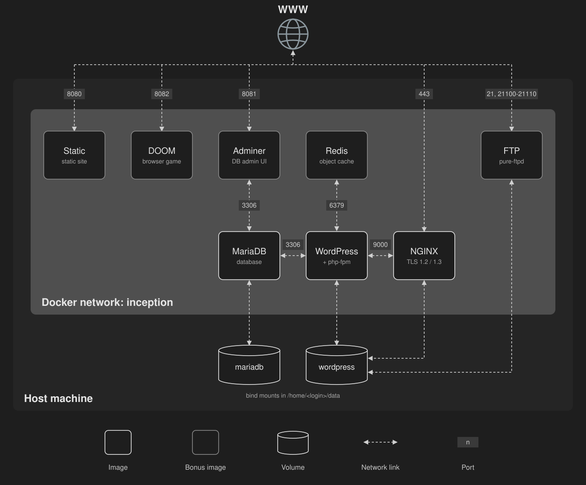

*This project has been created as part of the 42 curriculum by mtaheri.*

# Inception

## Description

A small infrastructure of Docker containers, each built from `alpine:3.23` with its own Dockerfile and orchestrated with Docker Compose.

- **Mandatory:** NGINX (TLS 1.2/1.3, sole entry point on 443) → WordPress + php-fpm → MariaDB.
- **Bonus:** Redis (WordPress object cache), FTP (pure-ftpd on the WordPress volume), Adminer, a static site and a DOOM browser game.



### Use of Docker and sources

Each service lives in `srcs/requirements/<service>/` with a `Dockerfile`, `conf/` (config files) and `tools/` (entrypoint). `srcs/docker-compose.yml` wires them together, `srcs/.env` holds non-secret config and `secrets/` holds passwords. The `Makefile` wraps everything.

Main design choices:
- Every container runs its daemon as PID 1 (`exec`), no `tail -f` / `sleep infinity`.
- Passwords are passed as Compose secrets (`/run/secrets/*`), never as env vars.
- WordPress waits for MariaDB's healthcheck; all services use `restart: always`.
- Data lives in two named volumes stored in `/home/mtaheri/data`.

### Virtual Machines vs Docker
A VM emulates hardware and runs a full guest OS, so it is heavy and slow to boot. A container shares the host kernel and only isolates processes, so it is light, starts in seconds and is built from a reproducible image.

### Secrets vs Environment Variables
Env vars are visible in `docker inspect`, `/proc/*/environ` and child processes. Secrets are mounted as files in `/run/secrets/`, only for the services that need them, and stay out of the image and the Compose config.

### Docker Network vs Host Network
A user-defined bridge network (`inception`) isolates the containers, gives them DNS by service name (`mariadb`, `wordpress`) and only exposes published ports. Host network removes that isolation: every container port is a host port.

### Docker Volumes vs Bind Mounts
Volumes are managed by Docker (named, portable, listed in `docker volume ls`). A bind mount maps a host path directly and depends on the host layout. Here, named volumes are used, with their data placed at a fixed host path (`driver_opts: o: bind`).

## Instructions

```sh
make          # create .env and secrets if missing, build and start everything
make host     # add the domain to /etc/hosts
make down     # stop and remove containers
make fclean   # also remove images, volumes and data
```

Then open https://mtaheri.42.fr. See [USER_DOC.md](USER_DOC.md) and [DEV_DOC.md](DEV_DOC.md) for details.

## Resources

- Docker — [Compose file reference](https://docs.docker.com/reference/compose-file/),
  [secrets](https://docs.docker.com/compose/how-tos/use-secrets/),
  [volumes](https://docs.docker.com/engine/storage/volumes/),
  [networking](https://docs.docker.com/engine/network/),
  [Dockerfile best practices](https://docs.docker.com/build/building/best-practices/)
- nginx — [documentation](https://nginx.org/en/docs/),
  [ngx_http_ssl_module](https://nginx.org/en/docs/http/ngx_http_ssl_module.html),
  [ngx_http_fastcgi_module](https://nginx.org/en/docs/http/ngx_http_fastcgi_module.html),
- WordPress — [nginx recipe](https://wordpress.org/documentation/article/nginx/),
  [wp-cli commands](https://developer.wordpress.org/cli/commands/)
- Adminer — [gh releases](https://github.com/vrana/adminer/releases)
- pure-ftpd — [documentation](https://www.pureftpd.org/project/pure-ftpd/doc/)
  and its [command-line options](https://linux.die.net/man/8/pure-ftpd)
- Redis — [Install and Configure Redis on WordPress - Cloudways](https://www.cloudways.com/blog/install-redis-cache-wordpress/)
  and the [Redis Object Cache](https://wordpress.org/plugins/redis-cache/) plugin.
- MariaDB — [documentation](https://mariadb.com/docs/server/mariadb-quickstart-guides/installing-mariadb-server-guide), [mariadb-install-db](https://mariadb.com/kb/en/mariadb-install-db/),
  [Configuring with Option Files](https://mariadb.com/docs/server/server-management/install-and-upgrade-mariadb/configuring-mariadb/configuring-mariadb-with-option-files#current),
  [server system variables](https://mariadb.com/kb/en/server-system-variables/),
  [TLS defaults in 11.4](https://mariadb.com/kb/en/secure-connections-overview/)
- Alpine — [Docker Hub image](https://hub.docker.com/_/alpine/)
- PID 1 and signals in containers — [Docker's discussion of init](https://docs.docker.com/reference/cli/docker/container/run/#init), [Containers and Signal Handling: Why You Need to Care About PID 1 - denibertovic.com](https://denibertovic.com/posts/containers-and-signal-handling-why-you-need-to-care-about-pid-1/)

### Use of AI

Claude Code was used as a pair-programming assistant on this project. Like drafting documentation and testing endpoints.
